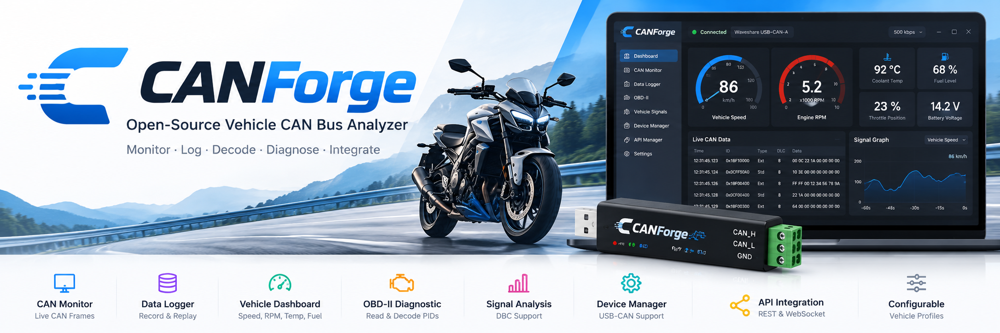

 

  

<h1 align="center">CANForge</h1>

  <strong>Open-Source Vehicle CAN Bus Analyzer & Diagnostics Platform</strong>

  Cross-platform CAN monitoring, data logging, OBD-II diagnostics,
  signal decoding, and vehicle-data integration.

  
  
  
  
  
  

---

## Overview

**CANForge** is an open-source, cross-platform desktop application designed for automotive engineers, embedded developers, and vehicle diagnostics enthusiasts.

The project aims to provide a unified platform for capturing, monitoring, recording, analyzing, and decoding vehicle CAN bus communication. It also aims to support standardized OBD-II diagnostics and expose decoded vehicle parameters through APIs for integration with external applications.
